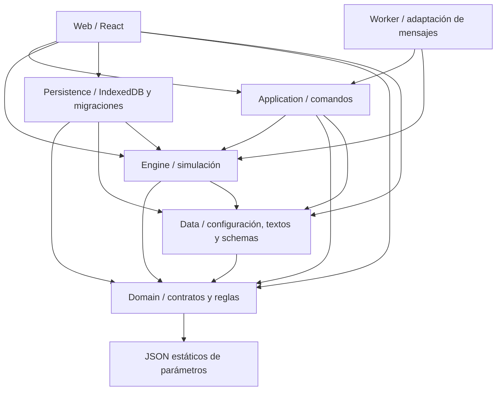

# Brooks-Lint Health Dashboard

**Mode:** Health Dashboard

**Scope:** MANDATO; inspección abreviada del código actual, guardado, distribución y pruebas. 7 de octubre de 2026. Código en solo lectura; se escribe exclusivamente este informe.

**Composite Score:** 95/100 — 95,33 antes del redondeo.
**Trend:** First run — no trend data.

La estructura y el motor están razonablemente bien protegidos; la entrega todavía necesita trabajo de producto y recuperación de fallos para una venta al público. Esta puntuación es el resultado de un escaneo técnico abreviado y acotado, **no una nota de diversión, acabado artístico, seguridad ni preparación comercial**.

| Dimension | Score | Top Finding |
|---|---:|---|
| Code Quality / PR | N/A | No hay diff de código que revisar; los cambios previos visibles son assets/documentos no seguidos. |
| Architecture | 100/100 | No se detectaron ciclos de importación entre módulos TypeScript; las responsabilidades generales están separadas. |
| Tech Debt | 90/100 | Dos Warning: comando de carrera que concentra muchos motivos de cambio y formulario antiguo inalcanzable. |
| Test Quality | 95/100 | Un Warning T5: falta protección frente a almacenamiento de preferencias denegado, que puede dejar la pantalla en blanco. |

Reglas `balanced`: base 100 por dimensión y −5 por Warning. PR se excluye y los pesos se redistribuyen según el skill: arquitectura 0,30/0,75; deuda 0,25/0,75; pruebas 0,20/0,75. Resultado: `100×0,40 + 90×(0,25/0,75) + 95×(0,20/0,75) = 95,33`. Los dos límites de producto que aparecen abajo no se convierten artificialmente en defectos de arquitectura para rebajar esa nota. No se encontró `.brooks-lint.yaml`.

## Module Dependency Graph

Se contaron 106 archivos `.ts`/`.tsx` en `src`, con 8.193 líneas contando saltos finales. El análisis de componentes fuertemente conexos no encontró ciclos entre esos archivos. Se resolvieron imports relativos `.js` a `.ts`/`.tsx`, incluyendo imports de tipos; no es una certificación de todos los posibles imports dinámicos o de dependencias npm. El acceso de Domain a JSON de parámetros estáticos no se trató como dependencia de infraestructura. Persistence puede importar creación y auditoría del mundo para migrar guardados porque es un adaptador de frontera.

## Top Findings

### 🟡 Warning

**T5 — Una preferencia bloqueada puede impedir abrir todo el juego**

Symptom: `useGameAudio` lee `localStorage` sin protección en [audio.ts](../../src/web/audio.ts), líneas 49–50, y escribe en la 53. [App.tsx](../../src/web/App.tsx), líneas 121–122, hace lo mismo con movimiento reducido. La raíz de React en [main.tsx](../../src/web/main.tsx), línea 9, carece de una recuperación general. En Chromium, sobre el build existente en `http://127.0.0.1:4180/`, se inyectó un `SecurityError` en `Storage.prototype.getItem/setItem`: `#root` terminó con cero hijos, `body.innerText` vacío y `pageerror = "Storage access denied"`. El control normal mostró dos hijos, inicio visible y ningún error. Las 153 pruebas del motor pasan pese a esa falla de la interfaz.

Source: *Code Complete* — Defensive Programming; *The Art of Unit Testing* — Test completeness principle; *How Google Tests Software* — protección de los caminos de fallo que importan al usuario.

Consequence: un navegador que deniegue ese almacenamiento puede presentar una pantalla blanca antes de que aparezca la ayuda o la posibilidad de recuperar una partida. Es una falla funcional reproducida bajo esa condición; no se midió su frecuencia entre usuarios y no significa que falle todo navegador privado.

Remedy: encapsular lectura/escritura de preferencias con valores por defecto en memoria y captura del error; dar recuperación visible cuando una pantalla no pueda montarse; añadir una regresión de navegador que deniegue Storage. La ayuda ya utiliza `try/catch` para sus preferencias, por lo que existe una solución local coherente.

**Entrega comercial — El comprador debe administrar un runtime y un servidor local**

Symptom: [README.md](../../README.md), línea 7, exige Node.js 22 o posterior, navegador actual, una ventana de servidor abierta y el mismo origen/navegador para recuperar el guardado. [package-game.mjs](../../scripts/package-game.mjs), líneas 10–11, genera un `.cmd` que verifica la existencia de `node`, abre la URL y ejecuta el servidor. No incluye el runtime ni un cliente empaquetado. El LEEME indica recargar si el navegador abre antes de que el servidor esté listo. Esta es una limitación de entrega y producto; no se deduce que usar una interfaz web sea malo.

Source: *Code Complete* — Construction and operational error handling; *Software Engineering at Google* — gestión de dependencias observables. La conclusión sobre la fricción de compra es juicio de producto, separado de la puntuación técnica.

Consequence: el lanzamiento depende de instalaciones externas y varios pasos que un comprador puede interpretar como un juego roto. El soporte tendrá que explicar Node, consola, puerto, navegador y recuperación de partidas. No se probó el paquete en un Windows limpio sin Node.

Remedy: entregar un instalador o paquete que incluya su runtime y abra una sola ventana de juego, espere el arranque real del servicio y almacene partidas en una ubicación estable; o escoger deliberadamente distribución web y diseñar un guardado acorde. Probar instalación, primera ejecución y actualización en equipos limpios.

**Guardado — Una nueva carrera normal sustituye la única carrera recuperable**

Symptom: [career-save.ts](../../src/persistence/career-save.ts), línea 18, define `ACTIVE_SAVE = "active"`; la línea 131 siempre escribe en esa misma clave. [App.tsx](../../src/web/App.tsx), línea 153, guarda automáticamente cada estado. El botón «Nueva carrera» en la línea 311 confirma el reemplazo exclusivamente en Ironman; una carrera normal nueva también acabará sobrescribiendo la anterior al empezar. El salón conserva perfiles de legado de carreras cerradas, no múltiples partidas completas recuperables. Hay exportación JSON manual.

Source: *Domain-Driven Design* — Aggregate lifecycle y propiedad del estado persistente; *Code Complete* — protección de operaciones que destruyen estado de usuario. Es una elección funcional actual y una limitación de UX; no se observó corrupción del contenido de los guardados.

Consequence: un jugador normal que explore otro país/personaje sin exportar antes pierde el acceso normal a su carrera anterior. La distinción visible «Ironman · guardado único» puede crear una expectativa diferente para las carreras normales. Los datos dependen además del origen y del perfil del navegador.

Remedy: ofrecer ranuras de carrera con nombres, un último respaldo recuperable y confirmación clara al reemplazar; reservar la restricción de una sola carrera para Ironman. Verificar guardado, reemplazo cancelado, restauración y actualización del paquete.

**R1 — El módulo de carrera reúne demasiados motivos de cambio**

Symptom: [career-commands.ts](../../src/application/career-commands.ts) contiene 1.565 líneas y 39 funciones exportadas. Abarca creación, campaña, algoritmos electorales, investidura, ministerios, Congreso, promesas, consecuencias sociales y legado. `advanceCareer`, líneas 1039–1159, concentra las transiciones de distintas etapas; las ramas de ejecutivo, liderazgo, ministerio y legislatura repiten el avance de economía y geopolítica. La interfaz pública de comandos y las pruebas son buenas bases de separación, por lo que esto se clasifica Warning de mantenimiento, no bloqueo funcional.

Source: *Refactoring* — Divergent Change / Long Method; *A Philosophy of Software Design* — Information Hiding; *The Mythical Man-Month* — Conceptual Integrity.

Consequence: añadir una etapa o cambiar las reglas de calendario exige entender numerosas invariantes que conviven en el mismo archivo. Es fácil corregir un avance trimestral en una rama y olvidar otra; crecerá el costo de implementar expansiones o corregir balance sin efectos secundarios.

Remedy: preservar la fachada de comandos y extraer módulos por ciclo de campaña, mandato, eventos y legado. Separar el paso trimestral compartido de las decisiones específicas de cada cargo, manteniendo pruebas de determinismo y restauración.

**R4 — Permanece un creador de personaje que ya no es alcanzable**

Symptom: [App.tsx](../../src/web/App.tsx), línea 280, enruta todos los casos sin partida y fuera de Ayuda a `Biography` o `StartScene`, según `personalizing`. En el siguiente nivel, líneas 281–294, permanece otro formulario antiguo de seis pasos bajo `!state`: no puede alcanzarse porque todos esos casos ya fueron capturados; en Ayuda se selecciona `HelpView`. Se conservan handlers de `wizardStep`, formulario, controles y presentación duplicada. Esta conclusión procede de las condiciones de render, no de asumir que dos diseños parecidos son duplicación indebida.

Source: *Refactoring* — Dead Code; *The Pragmatic Programmer* — Orthogonality; *A Philosophy of Software Design* — Tactical Programming.

Consequence: un cambio de biografía, nombres de controles o accesibilidad puede aplicarse en la versión inactiva y no afectar el juego real. El componente cuesta más de comprender y conserva superficie de presentación y estado innecesaria.

Remedy: eliminar el formulario inaccesible y sus estados/handlers exclusivos después de comprobar los recorridos de inicio, biografía, Ayuda y nueva carrera. Conservar los datos que sí usa el inicio rápido.

## Pruebas y comprobaciones ejecutadas

| Comando / comprobación | Resultado de esta revisión |
|---|---|
| `npm test` | Exit 0: 153 pruebas, 153 aprobadas, 0 fallidas, omitidas o canceladas; 33.175,92 ms de ejecución reportados. |
| `npm run build:worker-check` | Exit 0; TypeScript del Worker sin diagnósticos. `tsconfig.worker.json` usa `noEmit`. |
| `npx tsc -p tsconfig.json --noEmit` | Exit 0; sin diagnósticos. No se emitieron archivos de compilación. |
| `npm run data:check` | Exit 0: `10 browser profiles verified.` |
| `npm run content:validate` | Exit 0; 407 plantillas, 64 arcos de varios pasos, 80 plantillas internacionales, 10 arcos internacionales, 30 titulares y 1.628 entradas de texto estático; 0 duplicados literales y 0 incidencias. |
| `python -B tests/shock-reference.test.py` | Exit 0: una prueba Python aprobada. `-B` evita escribir bytecode. |
| Escaneo de imports de archivos TS/TSX | 106 archivos; ningún componente fuertemente conexo de más de un archivo. |
| Chromium: arranque normal / Storage denegado | Normal: inicio visible, sin `pageerror`. Storage denegado: pantalla vacía y `SecurityError`, reproducible mediante inyección explícita. |

**Test Suite Map:** hay 16 archivos `.test.ts` con 153 pruebas de motor, reglas, migración, adaptación del Worker y presentación de datos. Mezclan pruebas unitarias e integración determinista con datos reales del repositorio; no se inventa una separación numérica entre ambas. Los nombres expresan comportamientos y hay caminos adversos e invariantes, incluidos guardados dañados, referencias inválidas, pérdida de poder y costes de decisiones. No se detectó abuso sistémico de mocks ni dependencia de orden de ejecución.

Hay una regresión Python de semántica de datos y 17 scripts identificados de navegador/QA relevantes en `scripts` — son suites, no 17 casos individuales. El comando `npm test` no ejecuta esos recorridos. Los informes existentes documentan recorridos de navegador e importación/exportación, pero en este subanálisis no se repitió toda esa batería ni se certificó un equipo distinto.

## Límites de la evidencia

- No se modificó código, datos, assets ni configuración. El informe principal registra este escaneo técnico abreviado en `.brooks-lint-history.json`, con alcance explícito y separado del diagnóstico comercial.
- No se ejecutaron `npm run build`, `build:repro-check`, `package:pc` ni validaciones que regeneran informes o perfiles. Se comprobó el tipado del código actual y se utilizó el build `dist` existente para la reproducción de Storage; no se recalculó su correspondencia íntegra con todos los sources actuales.
- `content:validate` verifica cantidades, campos, IDs, referencias y repetición literal de texto. No verifica calidad literaria, diversidad de decisiones, corrección política, diversión ni coherencia causal de cada uno de los 407 textos.
- Pasar TypeScript, pruebas y auditorías de datos no establece FPS en distintos equipos, sesiones sin fallos de varias horas, compatibilidad universal, seguridad exhaustiva o equilibrio competitivo.
- La falla de Storage se indujo mediante una excepción compatible con denegación de acceso. No se midió la incidencia real ni se recomienda presentarla como la experiencia habitual.
- El guardado contiene validación Zod, migraciones desde versiones antiguas y auditoría de referencias geopolíticas. Son virtudes concretas y no se encontró evidencia de que el guardado normal corrompa una carrera.

## Recommendation

Antes de vender, resolver la pantalla blanca y entregar una primera ejecución sin administración técnica del comprador; el manejo de múltiples carreras y respaldos merece prioridad de producto. La deuda del módulo de comandos y el formulario inactivo son trabajos de mantenimiento con consecuencias futuras, no razones para declarar roto el motor actual. Para profundizar la dimensión técnica más débil, conviene una revisión de pruebas centrada en fallos de almacenamiento, actualización y entrega, junto con recorridos en equipos limpios. El motor ofrece una base considerable; la decisión comercial requiere además sesiones humanas, revisión editorial y evaluación del gameplay que esta puntuación técnica no cubre.
